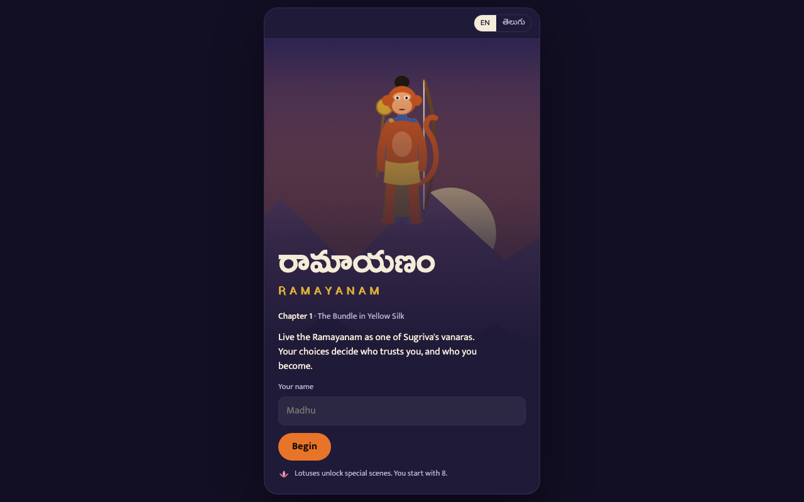

# Ramayanam Story Game

**▶ Live demo: [https://ateetgogineni.github.io/ramayanam-game/](https://ateetgogineni.github.io/ramayanam-game/)**

A choice-driven story game set in the Ramayanam, playable in English and Telugu.

You play an original young vanara in Sugriva's camp on Rishyamukha mountain. Rama, Sita and the
other main figures follow Valmiki's epic. Your choices change how scenes play out and who trusts
you, not the epic itself.

## Play

Open `index.html` in a browser. It's a single file with no build step. Fonts load from Google Fonts,
so the first load needs an internet connection.

Progress is saved in the browser's local storage.

## Chapter 1: The Bundle in Yellow Silk

- **Story choices** raise your bond with Hanuman, Sugriva and Lakshmana, and your Courage, Wisdom
  and Compassion. Some choices only appear because of something you did earlier.
- **Mini-games** with your own vanara on screen:
  - catch the bundle Sita throws down (drag, or hold ◀ ▶)
  - creep past Lakshmana unseen (hold to move, stop when he looks your way)
  - rub the fire-sticks to light the sacred fire (tap left and right in turn)
  - leap with Hanuman (hold, and let go in the gold band)
- **Lotuses** pay for special scenes. You start with 8 and can't afford all of them.
- **Animated characters**: they breathe, blink and sway their tails, and whoever is speaking talks
  and gestures.
- **English / తెలుగు** switch at the top, available at any point.
- **End of chapter**: a title based on your strongest bond, your scores and a recap of your choices.

## Code layout

Everything lives in `index.html`:

- `STORY`: the chapter as nodes of lines, choices, effects and mini-game results. Lines can depend
  on earlier events through `if` / `unless` flags.
- `CAST` / `LAYOUT`: who stands in each scene and where.
- `human()` / `vanara()`: the SVG characters. Animation is CSS.
- `GAMES`: the four mini-games.

## Next

Chapter 2: The Duel at Kishkindha.
